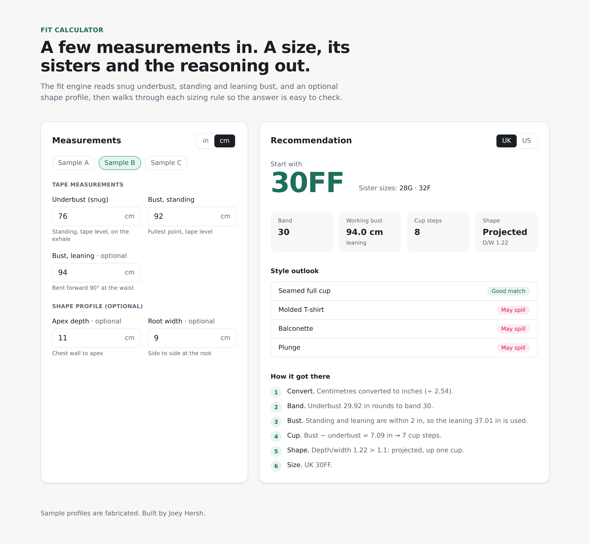

# Fit Calculator

**A bra-fit recommendation engine that shows its work.** Enter a snug underbust, a standing and a leaning bust measurement, and optionally a shape profile. The engine returns a band and cup, an alternate band when you sit between sizes, sister sizes, a shape read, and which cuts are likely to fit. Every rule it applies is printed alongside the answer.



The same engine ships twice: as a pure TypeScript package that runs in the browser, and as a Python module behind a FastAPI endpoint. Both are tested against one shared set of golden fixtures, so they can't quietly drift apart.

## Features

- **Measurements to size in one pass.** Band from snug underbust, cup from the bust-to-underbust difference, UK or US cup letters.
- **Standing + leaning bust.** Leaning forward captures tissue a standing measurement misses. Close readings use the leaning value; far-apart readings get blended.
- **Shape-aware.** Optional apex depth and root width give a depth-to-width ratio that classifies shape as shallow, balanced or projected and nudges the cup to match.
- **Style outlook.** Plunge, balconette, molded and seamed full-cup cuts are each patterned for a different depth-to-width ratio. The engine flags likely gapping or spilling for each one and ranks them.
- **Between-band help.** Underbusts near an odd number get a second option on the other band, with the cup adjusted to keep volume.
- **Sister sizes.** One band down and one cup up, or one band up and one cup down.
- **Explainable.** Each recommendation carries a step-by-step trace, which the UI renders as "How it got there".
- **Metric or imperial.** Toggle units and the inputs convert in place.
- **Two runtimes, one spec.** TypeScript in the browser, Python on the server, both held to `fixtures/profiles.json`.

## Quickstart

Requires Node 20.9+ with [pnpm](https://pnpm.io) (or `corepack enable`), and Python 3.11+ for the API.

```bash
git clone https://github.com/joey12725/fit-calculator.git
cd fit-calculator
pnpm install
pnpm dev            # web app on http://localhost:3000
```

Run the checks:

```bash
pnpm test           # engine + UI tests (Vitest)
pnpm lint && pnpm typecheck
pnpm build          # production build of the web app
```

Start the API (optional):

```bash
python -m venv .venv && source .venv/bin/activate
pip install -r apps/api/requirements.txt
pytest                                  # engine parity + endpoint tests
uvicorn apps.api.main:app --reload      # http://localhost:8000/docs
```

```bash
curl -s localhost:8000/fit/recommend \
  -H 'content-type: application/json' \
  -d '{"unit":"in","scale":"UK","underbust":31.25,"bustStanding":37,"bustLeaning":38.5}'
# → {"size":{"band":32,"cup":"F","label":"32F"},"alternate":{"band":30,"cup":"FF","label":"30FF"}, ...}
```

## How the fit model works

All math runs in inches. Centimetre input is divided by 2.54 first.

| Step | Rule |
| --- | --- |
| Band | Snug underbust rounded to the nearest even number (half up). |
| Working bust | Standing only: use it. Leaning within 2 in of standing: use leaning. Further apart: `(standing + leaning + 0.9 × leaning) / 3`. |
| Cup | `round(working bust − underbust)` cup steps: 1 = A, 2 = B, 3 = C and so on through the UK or US letter sequence. |
| Shape | Depth ÷ width above 1.1 is projected (+1 cup). Below 0.9 is shallow (−1 cup). Otherwise balanced. |
| Alternate band | Underbust within 0.5 in of an odd number also gets the neighbouring band with the cup shifted one step. |
| Sister sizes | Band −2 / cup +1 and band +2 / cup −1. |
| Style outlook | Your depth ÷ width over each cut's patterned ratio. Above 1.15 may spill, below 0.85 may gap, otherwise a good match. |

For example, the fabricated profile on the screenshot (underbust 76 cm, standing 92 cm, leaning 94 cm, depth 11 cm, width 9 cm) works out like this:

1. 76 cm is 29.92 in, so the band is **30**.
2. Standing and leaning are 0.79 in apart, so the working bust is the leaning 37.01 in.
3. 37.01 − 29.92 = 7.09 → **7** cup steps.
4. Depth ÷ width = 1.22, which is projected, so one more step: **8** (UK FF).
5. Result: **30FF**, sisters 28G and 32F. A seamed full cup is the closest style match.

[docs/fit-model.md](docs/fit-model.md) goes deeper, including the cup tables and how to tune thresholds.

## Architecture

```
.
├─ packages/engine/      # @fit-calculator/engine: pure TS fit engine + Vitest suite
├─ apps/web/             # Next.js 16 (App Router) + Tailwind CSS 4 calculator UI
├─ apps/api/             # FastAPI service + Python port of the engine (pytest)
├─ fixtures/profiles.json  # golden fabricated profiles both engines must satisfy
└─ docs/                 # fit model and architecture notes
```

The web app imports the engine directly and computes in the browser, so the calculator needs no backend and deploys as a plain Next.js site. The FastAPI service exposes the same logic at `POST /fit/recommend` for server-side callers such as a storefront, a CRM sync or a batch job. See [docs/architecture.md](docs/architecture.md).

## Tech stack

TypeScript · React 19 · Next.js 16 · Tailwind CSS 4 · Vitest + Testing Library · Python · FastAPI · Pydantic · pytest · Ruff · pnpm workspaces · GitHub Actions

## License

MIT. Built by [Joey Hersh](https://github.com/joey12725).
